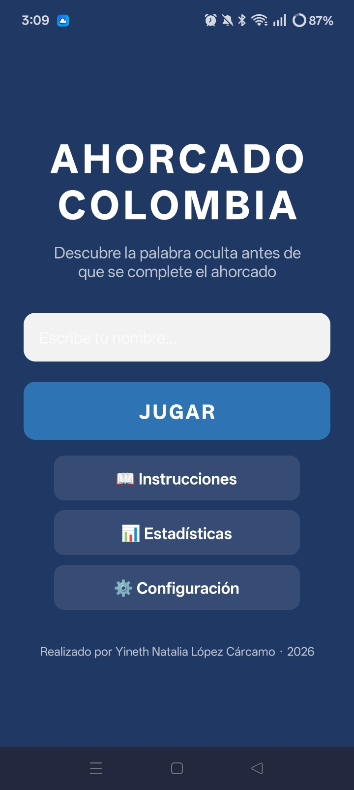
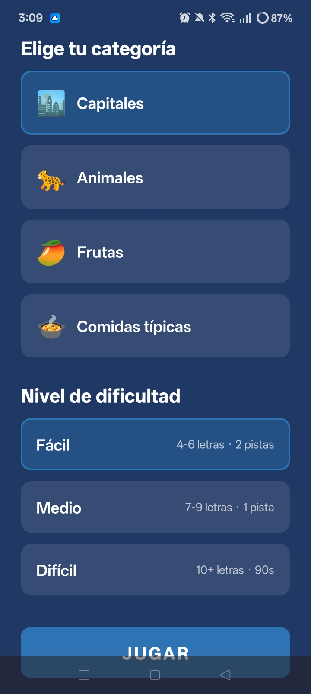
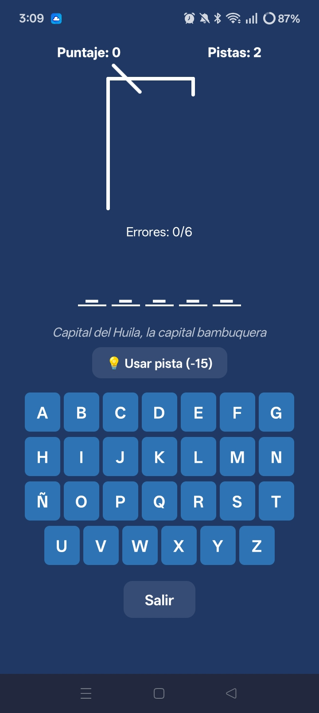
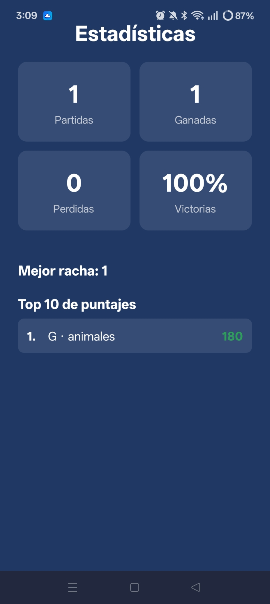
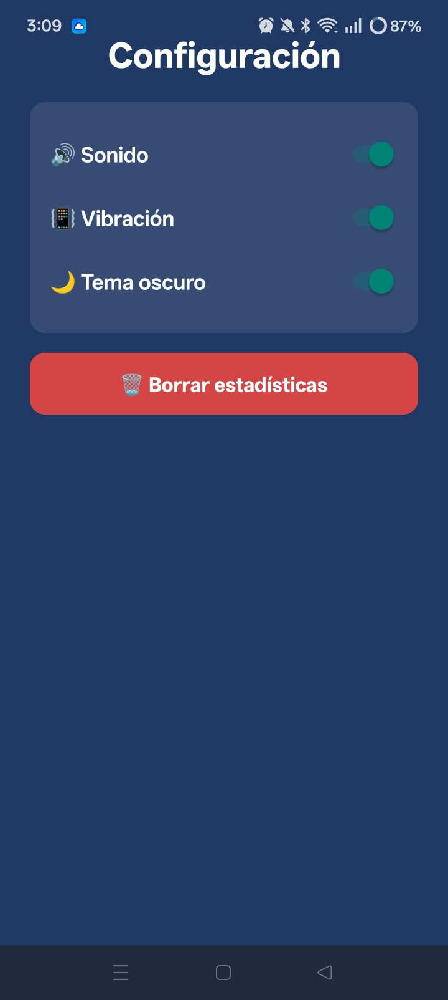
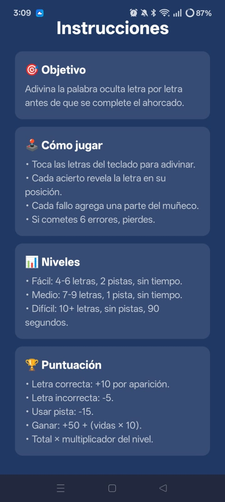

# El Ahorcado Colombia

Aplicación móvil del clásico juego del ahorcado, desarrollada con React Native y Expo. El jugador escribe su nombre, elige una categoría y un nivel de dificultad, y debe descubrir la palabra oculta tocando las letras de un teclado en pantalla antes de que se complete el dibujo del ahorcado.

El banco de palabras tiene temática colombiana: capitales, animales, frutas y comidas típicas.

## Tecnologías

- **React Native** con **Expo** (SDK 57)
- **JavaScript** (ES6+)
- **React Navigation** (stack)
- **AsyncStorage** para estadísticas, ranking y configuración
- **expo-haptics** para la vibración
- **expo-audio** para los efectos de sonido
- **EAS Build** para generar el APK

## Cómo ejecutar el proyecto

1. Clona el repositorio:
   ```bash
   git clone https://github.com/ynlopezcarcamo/ahorcado-app.git
   cd ahorcado-app
Instala las dependencias:

npm install
Copiar
Inicia el servidor de desarrollo:

npx expo start
Copiar
Escanea el código QR con la app Expo Go en tu celular Android.
Funcionalidades
Ingreso del nombre del jugador (obligatorio).
Cuatro categorías y tres niveles de dificultad.
Teclado en pantalla de la A a la Z, incluida la Ñ.
Dibujo progresivo del ahorcado en seis etapas.
Pistas según el nivel, con descuento de puntos.
Puntuación en tiempo real y multiplicador por nivel.
Cronómetro de 90 segundos en el nivel difícil.
Vibración y sonidos al acertar, fallar, ganar o perder.
Estadísticas, mejor racha y top 10 de puntajes guardados en el dispositivo.
Tema claro y oscuro.
Confirmación al presionar el botón «atrás» de Android durante la partida.
Estructura del proyecto

ahorcado-app/
├── App.js
├── app.json
├── assets/
│   └── sonidos/
├── src/
│   ├── navigation/     → AppNavigator.js
│   ├── screens/        → Inicio, Instrucciones, Categoría, Juego, Estadísticas, Configuración
│   ├── components/     → Ahorcado, PalabraOculta, Teclado
│   ├── hooks/          → useTema.js
│   ├── data/           → palabras.js
│   ├── storage/        → almacenamiento.js
│   ├── lib/            → sonidos.js
│   └── theme/          → colores.js
└── docs/diseno/        → exportación del diseño

Capturas de pantalla
## Capturas de pantalla









Enlaces
Diseño en Figma: https://www.figma.com/design/KiW4EUOqxswYOk972ASxtY/Sin-t%C3%ADtulo?node-id=35-147&t=TaecPHln8otY4ips-1
APK instalable: https://expo.dev/accounts/ynatalialopc/projects/ahorcado/builds/62544a31-d9dd-4fc3-9b13-7d24740591e3

Video explicativo: (agregar enlace)

Autor
Yineth Natalia López Cárcamo Programación Móvil — Uniciencia